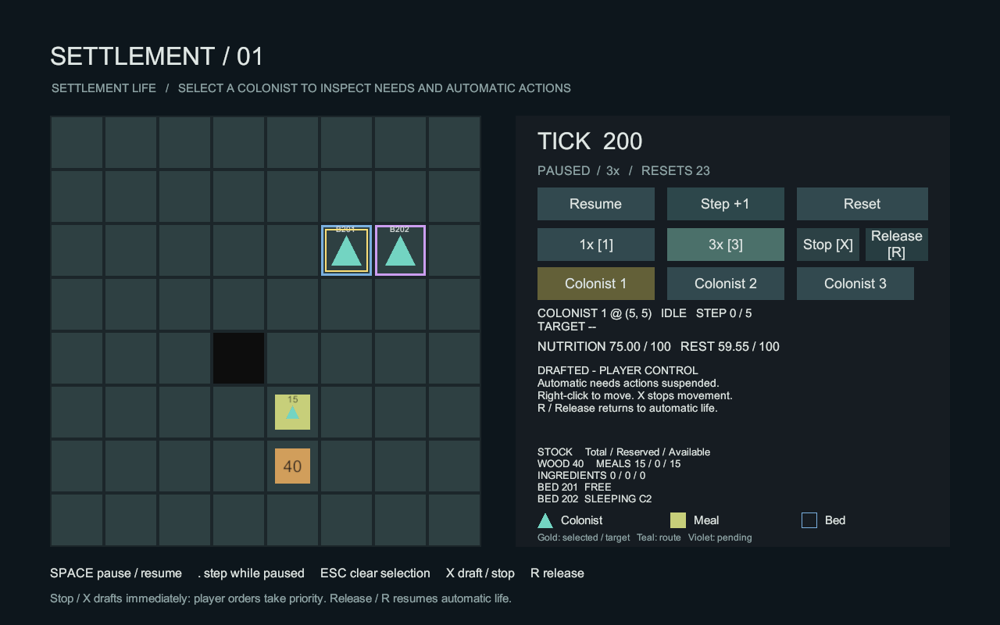

# 소집 중 플레이어 우선 검증

2026-11-15 사용자 요청: 생활 중 소집(Stop) 시 모든 행동보다 플레이어 조작을 우선한다. 기존 생활중Stop거부 규칙을 변경했다. Computer Use·커밋·원격 작업 없음.

## 구현

- Stop/X는 SetDrafted(id,true)를 즉시 적용한다. 일시정지 중에도 식사·수면·이동과 대기명령/예약/침대점유를 해제하되 Tick과 욕구 수치는 진행하지 않는다.
- 소집 상태는 정착민별 World 상태다. 자동 욕구 행동을 선택하지 않아 플레이어 이동·정지가 유지된다. 욕구 감소와 기아 이동 속도는 유지한다.
- 재Stop은 이동을 멈추며 소집을 유지한다. Release/R로 명시 해제하면 다음Tick 현재 욕구에 따라 생활을 재평가한다. Reset은 소집 상태를 초기화한다.
- 비소집 생활 중 우클릭만 LifeBusy로 안내하며 Stop/X로 먼저 소집할 수 있다. 전투·무기 기능은 추가하지 않는다.
- QueueStop은 이름을 유지하지만 이번 요구로 즉시 적용하는 호환 API다. 이동 명령은 기존대로 다음Tick 적용한다.

## 자동 검사

- EditMode58/58: `TestResults/20261115T082051724Z-264bdbec`.
- PlayMode21/21: `TestResults/20261115T082158980Z-49e2100e`.
- 다섯 생활상태(식사이동/식사/침대이동/침대수면/바닥수면)에서 즉시 소집·예약0·수량무소비·소집유지·플레이어이동·재Stop·해제를 검사했다.
- 식사 진행19/20에서 소집하면 다음Tick에도 소비0, 해제 후 새 식사를 끝낼 때만 소비1. 완료 후 Stop은 환불하지 않는다.
- 포만도/휴식0에도 소집 이동 가능, Reset으로 소집해제, 잘못된ID 거부.
- Pause중 버튼으로 소집해Tick1 유지, DRAFTED문구·Release활성 상태, X/R 단축키와 우클릭 명령 연결 검사.
- 기존 자동생활2400Tick·이동·시간 회귀 포함. 사람 입력은 엔진 내부 테스트로 대체하지 않는다.

## Windows 실행과 최종 대조

- Build: `TestResults/20261115T082241031Z-build`, 성공·오류0·경고0.
- Smoke: `TestResults/20261115T082330089Z-smoke`, 종료0·Passed=true·draftPassed=true. 일시정지 중 침대수면 소집→침대해제→플레이어 지정 타일 이동→해제까지 실제Player에서 검사.
- 기존 생활2400Tick 결과도 유지: 각 식사4회/수면2회, 기아0Tick, 식사12개 소비.
- Reset 전후 생활 UI251개/마커71개 동일. Release 버튼 추가로 이전249개에서2개 증가했으며 반복 중 누적 없음.
- 최종 Edit/Play/Build/Smoke 입력 전후8개 manifest와 현재130개 입력 해시가 동일. 빌드 출력183개 해시 일치.
- 실제1280×800 PNG를 열어 DRAFTED 표시, 침대201 FREE, Stop/Release 버튼과 단축키 안내를 확인했다. Release는 두 줄로 표시되며 잘림 없음.

기존 Player 종료 ComputeBuffer/D3D12 4096B 경고는 남아 있다. 장기간 GPU 프로파일링은 하지 않았다. 실제 사용자 마우스/키보드 및 창 크기별 확인은 대기다. 커밋 기준784f242 유지, 원격 연결 없음.
