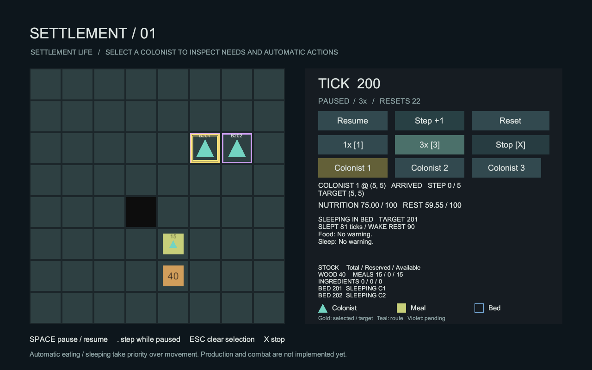

# 작업2 생활 기능 검증

2026-11-15. 사용자 구현 목표 재개 후 공통 계약/소유권을 유지하고 Simulation·Presentation·Tests 교차 검토와 병렬 보완을 수행했다. Unity 실행은 root가 소스 쓰기 동결 후 직렬 수행했다. Computer Use·OS 입력 주입·커밋·원격 작업 없음.

## 현재 결과

- Unity 6000.3.28f1, 기존 manifest/lock 유지.
- 최종 EditMode 56/56 통과: `TestResults/20261115T081003026Z-b0cf34bc`.
- 최종 PlayMode 20/20 통과: `TestResults/20261115T081051942Z-db6d5af4`.
- 각 실행 summary.json의 ProcessExitCode0, TimedOut=false, Verdict.Passed=true, Issues=[] 확인.
- Windows build 성공: `TestResults/20261115T081131246Z-build`, 오류0·경고0 (`Builds/Windows/build-summary.json`).
- Windows Player smoke 성공: `TestResults/20261115T081234513Z-smoke`, 종료0·타임아웃없음·입력변경없음.
- 최종 두 테스트/build/smoke 입력 전후8개 manifest와 현재 Assets/Packages/ProjectSettings/Tools 130개 파일 SHA256이 모두 일치. build-provenance의 모든 출력 해시도 일치.
- 실제 PNG1280×800, 표본114색. 에이전트 이미지 확인 완료. 새 생활 기능 사람 조작 확인은 대기.

## 완료 기준과 증거 범위

| 기준 | 검증 내용 |
|---|---|
| 2-A 욕구·시간 | 30/20 경계, 상하한, 초기값 거부, Pause 욕구 불변·Step1회, 독립 World·seed |
| 2-B 예약 | 식사1개 경쟁, 생식4개 원자 예약, 낮은 욕구/ID 순서, 침대1명, 자원 보존식 |
| 2-C 식사·이동 | 2칸 이동10Tick/식사완료30Tick, 우회8칸40Tick/완료60Tick, 19/20 및39/40Tick 소비 경계 |
| 2-D 수면·이동 | 이동 중 예약/도착 후 점유, 침대140Tick·바닥280Tick 회복,90기상, 회복 중 침대 삭제 대체 수면 |
| 2-E 충돌·복구 | 수면중허기 전환, 식량없는 수면 유지, 미적용 수동 명령 취소, LifeBusy, 우회예약유지/완전차단해제, 재공급복구 |
| 2-F 표시 | 실제 욕구/자원/침대 상태,7종 부족·기아 이유, 소진/삭제 마커 비활성 재사용, 선택·시간 입력 연결 |
| 2-G 반복 생활 | EditMode2400Tick 매Tick 물자 보존·욕구양수·침대소유 정합성, 세 명 식사/수면 완료, 상태별Reset10회,66/201/300Tick 배속 경로·예약 소유 일치 |

사람의 실제 마우스·키보드 조작, 창 크기별 가독성, 장기간 GPU 메모리 검증은 자동 검사 통과에 포함하지 않는다. UI 검사는 엔진 내부 API와 버튼 이벤트를 사용했다. 생산/자급·저장·전투는 범위 밖이다.

## 검토에서 발견하여 반영한 사항

1. 첫 EditMode51개는 통과했으나 수면 중 회복 후 침대 삭제 경계를 놓쳤다. 두 검토자가 독립 지적하여 root가 중단된 수면 의도를 그Tick에 보존하고 생활 결정 단계에서 대체 수면을 선택하도록 수정했다. 검사:20.50→침대삭제20.45/바닥수면→다음Tick20.70. 신규 수면은 같은Tick 회복하지 않는다.
2. 배속 버튼은 기존 계약대로 재개한다. 이를 일시정지 유지로 가정한 테스트를 수정하고 Pause 욕구 불변을 명시적으로 검사했다. Player 배속 비교도 양쪽300Tick 도달을 요구한다.
3. 수면은 고정 행동시간이 없으므로 ACTION60/0 표시를 없애고 수면 경과Tick과 기상 기준REST90을 표시했다.
4. 검사 담당자가 후보 경로·생식 대안·침대 경쟁·화면 이유·Reset 사전상태 누락을 보완하여 기존46개를 포함한76개로 확대했다.

첫 실행 `20261115T080617347Z-0b118cc3`의51/51 통과는 보완 전 자료로 보존한다. 처음 제한 환경에서 실행한 CLI는 CIM 접근이 불가능하여 Unity 시작 전 종료되었고, 이후 승인된 실행 환경에서 검증했다. 실패나 과거 결과를 최종 결과로 덮어쓰지 않는다.

공통 계약: [Living](../Contracts/Living.md). 계획: [작업2](../Plans/Task2-Needs-Food-Sleep.md). 사용자 확인: [생활 데모](../LivingDemo.md).

## Windows 관측 결과

2400Tick 동안 각 정착민 식사 [4,4,4], 수면 완료 [2,2,2], 기아 누적0Tick. 총 식사 소비12개로 초기18개 중6개가 남았다. 예약 관찰·침대 점유 관찰·배속 동등성·기존 이동 회귀 모두 true. 기존 이동 fixture의69개 마커/245개 UI 객체와 생활 fixture의71개 마커/249개 UI 객체가 각 Reset 전후 동일하다. UI 수는 초기 기준점과 달라졌지만 반복 초기화 중 증가하지 않는다.

최종 캡처는 초기화 후Tick200이다. 정착민1은 침대201에서 수면, 포만도75/휴식59.55, 식사15개·목재40, 침대201/202에 각각1/2번 정착민이 표시된다. 세 번째 정착민은 식량 타일에서 바닥 수면 중이다. 2400Tick 종료 화면과 혼동하지 않는다. 자원 수량·욕구·수면 시간·기상 기준·침대 소유 상태의 표시를 확인했다. 선택된 침대의 작은 타일 ID는 외곽선과 가까우나 우측 TARGET201/침대 목록에서 대상 확인이 가능하다. 창 크기별 가독성은 사람 확인 대상이다.

## 남은 한계

Player 종료 시 기존 `GarbageCollector disposing of ComputeBuffer` 및 D3D12 미해제4096B 경고가 남는다. 이번 기능의 실행·검사 실패는 없지만 GPU 자원 정리가 검증 완료됐다는 뜻은 아니다. 장기간 프로파일링은 수행하지 않았다. 실제 키보드·마우스 조작과 다양한 창 크기 확인은 [생활 데모5단계](../LivingDemo.md)로 사용자가 진행한다.

최종 Git 기준 커밋은784f242 그대로이고 원격0개. 공유 폴더 유지. 커밋하지 않았다.
