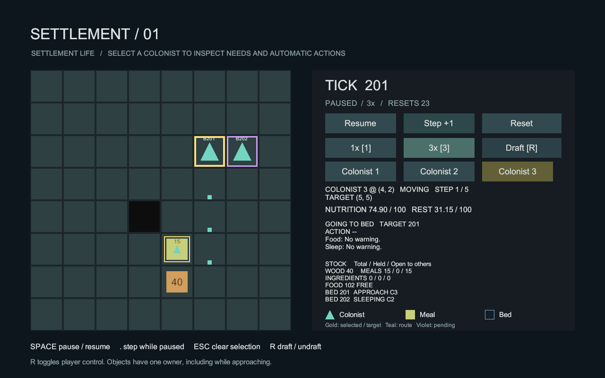

# R 토글·단일 점유·침대 재선택 검증

2026-11-15. [공통 계약](../Contracts/InteractionOccupancy.md)을 먼저 확정한 후 단일 담당자가 시뮬레이션·화면·검사·Player 검증을 통합했다. 기존 수량 기반 복수 음식 예약 및 바닥 수면 고정 검사는 새 요구에 맞게 변경했다. Computer Use·OS 입력 주입·커밋·원격 작업은 하지 않는다.

## 변경과 검증 범위

| 계획 | 구현과 검사 증거 |
|---|---|
| I-1 | OwnerId+OwnerActionId, Pawn.ActionId/HasSleepIntent. World 단위 상태. 획득/도착/소비/해제에서 행동 세대 검사 |
| I-2 / O-11 | DraftButton 하나, R 토글, X 입력 경로 제거. Pause 중 즉시 취소. 엔진 가상 KeyboardState로 눌림/홀드/재입력 검사, 실제 OS 키 입력은 별도 |
| I-3 / O-01,05,06,07,08 | 식사18개스택 소유자1명/확보1/미확보17/타Pawn접근가능0. 취소후18·완료후17. 다른스택은별도소유. 접근중침대도점유. 이전ActionId 취소·Release·Consume가현재점유에영향없음을검사 |
| I-4 / O-02,03,04,09,10 | A접근중소집→휴식35인B바닥수면자의다음Tick침대획득. 획득전바닥수면유지. 이동중회복없음.90완료/소집제외. 낮은Rest→ID경쟁. 막힌경로재시도와개방재개. 식사개입/침대삭제후수면목적유지 |
| I-5 | FOOD와BED 소유자·APPROACH/USING(SLEEPING)단계, Total/Held/Open구분. 버튼Draft/Undraft상태와취소후FREE표시 |
| I-6 / O-12 | 2400Tick매Tick독점·보존·기아검사,동일Tick배속/행동세대/수면목적/점유비교,상태별Reset10회·월드독립. Windows/PNG는아래최종결과기록 |

식량·침대를 새 행동 세대로 확보한 뒤 기존 행동을 정리한다. 이 과정은 동기 결정 단계에서 중간상태를 외부에 노출하지 않고 수행한다. EndLife는 이전세대점유만 해제하므로 새로 확보한 대상이 취소되지 않는다. 획득 실패 시 바닥 수면을 중단하지 않는다.

수면목적은 진입임계값20과 별개다. 식사 개입 검사는 식사후에도휴식20초과인조건으로수면재개를확인한다. 바닥→침대전환은수면완료로세지않고90에서한번완료한다.

## 실행 이력

- 초기 EditMode63개: `20261115T084603135Z-132d8b1f` 통과. 획득 순서와 수면 목적 조건 보강 후 `20261115T084814296Z-31d78b80` 63개 통과.
- PlayMode `20261115T084845401Z-319c4ba3`: 23개 중 가상R입력검사1개 실패, 나머지22개 통과. 프레임대기 기반 첫눌림을 잡지못했다.
- PlayMode `20261115T085016687Z-72fa1198`: 명시적 InputSystem.Update 후 isPressed는true였으나 첫눌림 처리검사 실패. 설치된 InputSystem ButtonControl의 첫읽기/이전프레임 판정코드를 확인하고 가상 키보드를 기본상태로 먼저 갱신하는 준비단계를 추가했다. 제품 입력을통과로가정하거나 검사를삭제하지않았다.
- `20261115T085151132Z-33071310`도 같은 검사 실패. 기본상태 준비 후에도 isPressed=true/wasPressedThisFrame=false인 조건을 확인했다. R은 InputSystem의 프레임 플래그 대신 화면 입력 갱신 간 눌림 상태 상승 경계를 직접 감지하도록 변경했다. 검사는 동일 가상 키보드로 첫누름·홀드·X·R재입력을 유지한다. OS 입력 주입은 하지 않았다.
- 최종 검증 결과는 아래에 추가한다. 이전 실패 로그는 보존한다.

## 한계

실제 사람 R키·마우스 입력, 창크기별가독성, 장기간 GPU프로파일링은 자동검사 범위 밖이다. 채집·운반·조리·농사·건설·전투·저장은 구현하지 않는다. 음식 낱개 분리·복수 사용슬롯·다중대상 동시점유도 범위 밖이다.

## 최종 실행 결과

| 검사 | 증거 폴더 | 결과 |
|---|---|---|
| EditMode | TestResults/20261115T085438401Z-2b229798 |64/64, 종료0·누락/skip0 |
| PlayMode | TestResults/20261115T085359298Z-5eff0dd3 |23/23, 종료0·누락/skip0 |
| Windows Build | TestResults/20261115T085600614Z-build | 성공·오류0·경고0 |
| Windows Player Smoke | TestResults/20261115T085647423Z-smoke | 종료0·Passed=true·draftPassed=true·occupancyReassigned=true |

최종검사·빌드·실행의입력전후8개manifest와현재입력130개SHA256이모두같다. Build provenance의입력과출력183개해시도일치한다. 최종소스에서총87개검사가통과했다.

2400Tick에서식사[4,4,4],수면[2,2,2],기아0Tick,식사소비12개. 단일스택독점으로중간행동타이밍은변했지만2일완료조건은유지됐다. Reset전후생활UI249개/마커71개,이동fixture UI245개/마커69개유지. 기존Stop/Release두버튼을Draft토글하나로줄여UI객체가이전251개에서249개가됐다.

실제PNG1280×800·표본102색, 에이전트가이미지를열어확인했다. 초기화후Tick200에서1번Pawn을소집하고1Tick진행한Tick201을캡처했다.3번Pawn은휴식31.15로20을넘었지만침대201을점유하여이동중이며표시는BED201 APPROACH C3다.2번은침대202에서수면중,식사15개/확보0/타Pawn접근가능15다. R토글버튼·경로·상태·소유자문구가겹치거나잘리지않는것을해당해상도에서확인했다.

Player종료시기존ComputeBuffer/D3D12 4096B정리경고는남아있다. 빌드경고0은종료경고가없다는뜻이아니다. GPU장기검증은하지않았다.

## 사람 확인과 Git 상태

2026-11-15 사용자가 이동·생활·소집·점유 기능을 “모두 정상”으로 확인했다고 보고했다. 이는 자동 검사와 별도인 사용자 확인 증거다. 상세 해상도·입력 로그나 장기 GPU 검증까지 확인됐다는 의미는 아니다.

사용자가 제안한 통합 기준 커밋 `Add settlement movement, living needs and exclusive interactions`를 승인했다. 포함 범위는 초기784f242 이후의 실행 데모·이동/시간·생활·소집·점유·CLI검사·관련문서다. [커밋 전 점검](2026-11-15-baseline.md)에 최종 입력 대조와 범위를 기록한다. 원격 연결·push는 하지 않으며 이후 커밋은 다시 승인받는다.
