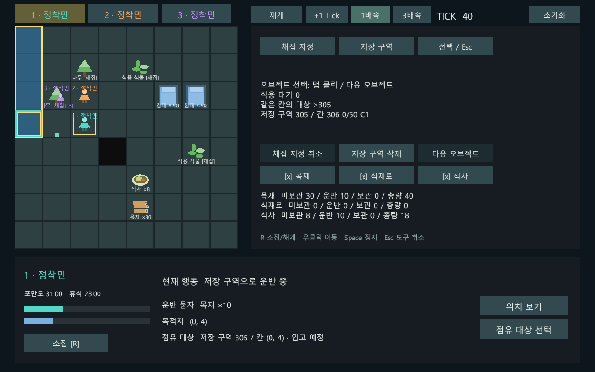

# 식별·하단 선택 UI 검증

2026-11-15. [확정 계약과 root 파일 소유권](../Contracts/ReadableSettlementUI.md)에 따른 표시 개선이다. 이전 채집·운반·저장은 사용자가 정상 동작을 확인했다. 이번 UI는 별도 검증하며 커밋·Computer Use·원격 작업은 하지 않는다.

## 구현 내용

- 정착민 ID별 고정 색상, 사람 형태, 상시 번호·이름, 소집 배지. 같은 칸과 맵 상단 가장자리에서도 이름을 분리한다.
- 사람·나무·식물·접시·바구니·통나무·침대의 벡터 심볼과 이름·수량. 외부 이미지나 글꼴 파일을 배포하지 않고 Windows 한국어 시스템 글꼴을 사용한다.
- 저장 구역의 반투명 바닥과 외곽선. 물자와 정착민보다 아래에 렌더하며 개별 칸 용량은 선택 정보에서 확인한다.
- 하단 선택 정보: 현재 행동·진행도·대기 이유, 실제 운반량, 목적지, 실제 점유 대상, 포만도·휴식도 막대와 수치, R 버튼. 대상 선택 버튼은 해당 물자·침대·채집 대상·저장 구역을 선택한다.
- 작업 도구/필터/물자 합계는 우측, 정착민과 시간 조작은 상단에 유지한다. 생활·작업 탭 전환은 필요하지 않다.

## 실행 기록

| 실행 | 결과와 조치 |
|---|---|
| `20261115T100529731Z-05c19b8d` | PlayMode26개 중21개 실패. 버튼 이름의 `/`가 Transform 경로로 해석되어 새 UI 초기화 실패. 이름 직접 비교로 수정 |
| `20261115T100634755Z-a6fea4e9` | 초기화 복구 후10개 실패. 기존 Image 렌더/숫자 전용 라벨/영문 문구 기대와 실제 대기 이유 누락을 확인 |
| `20261115T100917957Z-7b543613` | 대기 이유와 기존 UI 기대를 보완한 뒤4개 실패. 남은 숫자 전용 라벨 검사를 이름×수량으로 변경 |
| `20261115T101056451Z-2fc9e43e` | 기존26개 + 신규4개, PlayMode30/30 통과 |
| `20261115T101233579Z-0e42aa3c` | 도구/물자 한국어 문구와 이름 버튼 반영 후 PlayMode30/30 통과 |

기존 검사의 목적(동일 월드, 올바른 좌표·수량·명령·시간·점유·Reset)은 유지한다. Image에서 벡터 Graphic으로 렌더 방식이 바뀌고 라벨에 이름이 추가된 부분만 승인된 UI 기준으로 바꿨다. 실제 누락이었던 대기 이유는 검사 삭제로 처리하지 않고 제품 표시를 보완했다.

신규 검사는 3명이 맵 끝의 같은 칸에 있어도 이름 위치가 겹치지 않고 색상이 서로 다른지, 소집/Reset 후 ID 색상이 유지되는지 확인한다. 7종 심볼과 한글 글리프, 2×2 저장 구역의 바닥4개·외곽선8개·개체보다 아래 순서, 삭제 후 표시 해제, 실제 운반물/목적지/점유 값과 하단 패널·대상 선택·R 취소를 확인한다.

## 실제 사용자 확인

Windows 빌드·실제 Player·렌더·최종 해시 대조는 아래 실행에서 완료했다. 사람이 보는 가독성과 실제 마우스 조작 확인은 [UI 확인 안내](../ReadableUiDemo.md)에 따라 별도로 남긴다. 구현·자동검증 완료와 사용자 확인 대기를 구분한다.

중간 Windows 빌드 `20261115T101319687Z-build`와 Player `20261115T101407224Z-smoke`는 성공했다. 실제 PNG에서 한글·새 심볼·하단 정보는 보였으나 나무 라벨과 아래 칸 Pawn 이름이 겹치고 나무에 Pawn 모양이 가려지는 결함을 발견했다. 라벨을 각 타일의 위/아래 영역으로 분리하고 Pawn을 위에 렌더하며 같은 칸 오브젝트와는 사람 모양을 옆으로 배치하도록 보완 중이다. 이 이미지로 최종 가독성 완료를 주장하지 않는다.

## 최종 검증

| 항목 | 결과 | 실행 폴더 |
|---|---|---|
| EditMode | 80/80 통과 | `TestResults/20261115T102222720Z-bddf87e0` |
| PlayMode | 30/30 통과 (기존26 + 신규4) | `TestResults/20261115T102026410Z-d52cdaef` |
| Windows 빌드 | Succeeded, 오류0·경고0 | `TestResults/20261115T102105807Z-build` |
| 실제 Player | 종료0·기능 판정 전체 true | `TestResults/20261115T102207834Z-smoke` |
| 실제 렌더 | 1280×800·표본색112·한글/배치 확인 | 같은 폴더 `demo.png` |

수정된 PNG에서 정착민 이름은 각 타일 상단, 물자·나무·침대 이름은 하단에 분리되고 정착민 모양이 나무 위에서 보인다. 상단 목록의 번호/고유색과 맵 이름이 대응하며, 바닥 저장 구역과 하단 운반/목적지/실제 점유 정보가 표시된다. `20261115T101720746Z-smoke`에서 직접 확인한 수정 후 이미지와 최종 PNG의 SHA-256은 동일하다.

| 계약 단위 | 근거 |
|---|---|
| UI-1 정착민 식별 | 신규 이름/고유색/같은 칸/맵 끝/소집/Reset 검사와 실제 PNG |
| UI-2 오브젝트 식별 | 7종 벡터 심볼·이름×수량·한글 검사, 실제 나무/식물/식사/목재/침대 렌더. 식재료는 자동 심볼 검사로 확인 |
| UI-3 저장 구역 | 2×2 바닥4·외곽선8·객체 아래 순서·삭제 표시 해제 검사와 PNG |
| UI-4 하단 정보 | 실제 운반량/목적지/점유 값 검사, 기존 생활 상태·부족 이유 UI 회귀, 실제 운반 장면 |
| UI-5 선택 연결 | 점유 대상 선택·R 후 점유 없음/버튼 비활성 검사, 기존 맵/목록/겹침/시간/Reset 조작 회귀 |
| UI-6 통합 | 전체110개, Windows 생활/물류2400Tick·소집/필터 복구·배속 동등성·Reset 및 렌더. 사람 확인은 대기 |

Player의 기존 시뮬레이션 관측도 유지됐다. 작업2400Tick에 목재20/식재료8 생산, 초기분 포함 목재60 보관, 식재료8 생식 소비, 기아0Tick이다. 매 Tick 수량 보존, R 낙하/해제, 필터 복구, 배속 동등성 판정이 모두 true다.

최종 네 실행의 입력148개가 현재 Assets·Packages·ProjectSettings·Tools SHA-256과 모두 일치하고, 빌드 출력183개도 provenance와 일치한다. UI 작업 시작 시 기록한 Simulation·Runtime·Packages·ProjectSettings 62개는 변경0건이다. 빌드 도중 Unity가 일시적으로 바꾼 preloadedAssets는 빌드 종료 후 원상복귀했으며 최종 해시로 확인했다. 미사용 표시 변수 경고1건은 제거했고 최종 빌드는 경고0이다.

Canvas는 Expand 방식으로 비율 변화 시 기준1280×800 영역이 잘리지 않도록 했다. 기존 여러 Canvas 스케일에서의 맵 좌표/경계 검사는 통과했으나, 실제 PNG 검토는1280×800에서 수행했다. 다른 OS/해상도의 실제 플레이 가독성은 검증하지 않았다. 기존 Player 종료 ComputeBuffer/D3D12 4096B 경고와 장시간 GPU 프로파일링 미실행은 별도 남은 항목이다.

커밋·원격 연결·push·Computer Use는 하지 않았다. 이전 채집 기능의 사용자 정상 확인을 이번 UI의 사용자 확인으로 간주하지 않는다.

## 후속 사용자 확인 (2026-11-15)

사용자가 “모두 정상으로 확인했어”라고 보고했다. 위의 사용자 확인 대기는 당시 기록이며 현재는 정상 확인 완료다. 별도의 해상도/OS/장시간 GPU 검증을 수행했다는 의미는 아니다. 이번 커밋 제안 검토에서 최종 검사 입력150개와 빌드 출력183개의 현재 해시 일치를 재확인했다. 새 Unity 검사는 실행하지 않았다.
