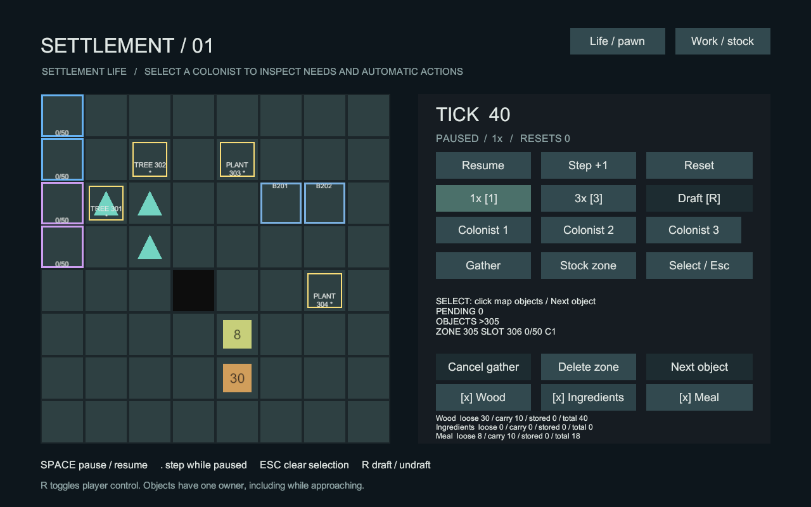

# 작업3 채집·운반·저장 검증

2026-11-15. 기준 `7d20688` 이후의 미커밋 변경이다. [공통 계약·소유권](../Contracts/GatherHaulStorage.md), [기능 계획](../Plans/Task3-Gather-Haul-Storage.md), [사람 조작 확인](../WorkDemo.md)을 따른다. Computer Use·원격 작업·커밋 없음.

## 구현과 자동 검사

- 유한 채집 대상 지정과 진행도 보존, 저장 구역·필터, 한 번에10개/칸당50개 운반·저장, 출발 스택→저장 칸의 점유 전환을 구현했다.
- 저장 칸과 보관 스택이 같은 권한을 공유하며, 취소·R·생활 중단 시 운반물을 바닥에 보존한다. 전역 채집 지정과 Pawn의 실행 행동을 분리했다.
- 생활 선택을 노동의 집기·입고보다 먼저 처리해 같은 Tick의 음식 점유 경쟁에서 생활을 우선한다. 바닥 수면자의 기존 빈 침대 재선택 규칙은 유지한다.
- 작업 도구, 두 모서리 저장 구역, 필터·삭제, 겹친 개체 ID 선택, 미보관/운반/보관/총량을 표시한다. Runtime 기본 시나리오는 기존 생활 배치에 나무2/식물2를 추가했다.

| 실행 | 결과 | 증거 |
|---|---|---|
| 기존 EditMode 회귀 | 64/64 | `TestResults/20261115T092013005Z-41404b87` |
| 신규 초기 13개 포함 | 77/77 | `TestResults/20261115T092255878Z-4a8cb825` |
| 통행 복구·생활 경쟁·Reset 포함 | 80/80 | `TestResults/20261115T092755144Z-7c08bfce` |
| 입력·표시 통합 초기 | 26/26 | `TestResults/20261115T092615803Z-dac62dae` |
| Windows 검증 코드 추가 시 컴파일 실패 | 실행0, 실패로 기록 | `TestResults/20261115T092915388Z-aad9a2f9` |
| 불필요한 InputSystem 직접 참조 제거 후 | PlayMode 26/26 | `TestResults/20261115T092943052Z-3e8897c3` |

실패는 Demo asmdef가 참조하지 않는 입력 모듈의 Key 타입을 검증 코드에서 사용한 것이었다. View의 도구 API로 교체하고 재검사했다. 패키지나 asmdef 참조를 늘리지 않았다.

## 확인한 관측값

EditMode는 나무 현장60Tick→목재10, 식물30Tick→식재료4, 취소 시 진행도 유지·산출0, 도착 칸45/50에서5개만 집기, 두 Pawn의 목적지 경쟁, 운반 각 단계의 R 취소, 오래된 행동 ID 무효, 통로 완전 차단 후 물자 보존·재개, 음식 운반 중 낙하 후 식사, 수면 목적 유지, 필터/구역 삭제 후 수량 보존을 검사한다.

3명·나무2·식물2·저장4칸의 300Tick 물류 검사에서 목재20/식재료8이 모두 보관되고 운반물·미완료 지정·점유가 남지 않는다. 별도 생활 검사와 시간 분할/Reset 검사를 수행했다. 기존64개는 이동·생활·소집·음식 독점·침대 재선택의 회귀다. PlayMode26개는 기존23개와 신규3개로 실제 View/Runner 연결, 대기 표시, 필터 버튼, 도구 취소, 동적 물자 표시 및 Reset을 확인한다.

## 사람 확인과 범위

Windows 빌드·Player smoke·실제 렌더 확인은 아래 최종 실행에서 통과했다. 실제 마우스·키보드와 화면 가독성의 사용자 확인은 자동 검사로 대체하지 않는다. [WorkDemo](../WorkDemo.md)의 5단계 확인을 별도로 요청한다. 농사·조리·장기 자급은 이번 완료 범위가 아니다.

## Player 초기 실행에서 발견한 검사 조건 수정

`20261115T093023404Z-build`는 오류0·경고0으로 성공했다. `20261115T093139852Z-smoke`에서는 기존 생활·이동·소집 검증과 작업2400Tick 수량 보존이 통과했지만, 작업 결과 판정에서 보관 식재료8개를 기대해 실패했다. 실제 관측은 생산8·보관0이었다. 생활이 포함된 시나리오에서는 생식 소비가 가능하므로 최종 검사는 생산량=보관량+실제 생식 소비량을 확인하고 미보관·운반 잔량0도 요구하도록 변경했다. 소비량은 재실행에서 직접 기록한다. 물류만 검사하는 EditMode의 생산20/8 전량 보관 조건은 유지한다. 실패 시 PNG가 없는데 렌더 검사부터 수행하던 실행기도 Player의 실패 이유를 먼저 보고하도록 보완했다.

## 최종 실행과 완료 기준 대조

| 항목 | 최종 결과 | 증거 폴더 |
|---|---|---|
| EditMode | 80/80 (기존64 + 신규16) | `TestResults/20261115T093450756Z-0e9cb912` |
| PlayMode | 26/26 (기존23 + 신규3) | `TestResults/20261115T093404977Z-0155fa68` |
| Windows build | Succeeded, 오류0·경고0 | `TestResults/20261115T093546936Z-build` |
| 실제 Player | 종료0, 모든 기능 판정 true | `TestResults/20261115T093639538Z-smoke` |
| 실제 렌더 | 1280×800, 표본색126, 이미지 내용 직접 확인 | 같은 폴더 `demo.png`, 아래 사본 |

Player에서 작업2400Tick 동안 목재20/식재료8 생산, 목재60 보관, 식재료8 생식 소비·잔량0, 기아0Tick을 확인했다. 매 Tick 자원 종류별 보존식을 검사했다. R 운반물 낙하·점유 해제, 필터 해제 시 목재60 보존 및 재허용 시 재입고, 동일 게임 시간 1/3배속 상태 일치를 확인했다. 기존 생활2400Tick은 각 Pawn 식사4회·수면2회, 총식사12개 소비·기아0이었다. 바닥 수면자의 해제 침대 재점유도 true다.

첫 실제 렌더에서 새 작업 마커의 pivot이 좌하단이라 표시가 반 칸 치우친 것을 발견했다. 중심 pivot으로 수정하고 PlayMode에 타일 경계 검사를 추가한 뒤 재빌드·재실행했다. 최종 이미지에서 저장 칸 테두리가 맵 경계 안에 있고, 지정 대상·점유색·도구·필터·운반 포함 물자 총량이 표시되는 것을 확인했다.

| 기능 단위 | 근거와 상태 |
|---|---|
| 3-A 공통 행동/물자 보존 | WorkTests 취소4단계·오래된 Action ID·생식 전환, Player 매 Tick 보존식. 구현·자동검증 완료 |
| 3-B 저장 구역/필터 | 영역 거부·부분 용량·공유 권한·필터/삭제/복구 검사. 구현·자동검증 완료 |
| 3-C 채집 | 59/60·29/30Tick 경계, 지정 취소·진행20 후 담당 교체, 산출 한 번. 구현·자동검증 완료 |
| 3-D 운반 | 목적지 경쟁·5개 부분 운반·취소·통로 차단/개방. 구현·자동검증 완료 |
| 3-E 생활/소집/복구 | 기존87개 회귀, 새 식사/입고 같은 Tick 경쟁·식량 없을 때 채집·수면 목적 유지, Player2400Tick. 구현·자동검증 완료 |
| 3-F 조작/표시 | 새 PlayMode3개와 실제 렌더. 구현·자동검증 완료, 실제 사람 조작 확인 대기 |
| 3-G 통합 | 전체106개·Windows build/Player·배속 비교·해시 대조 완료. 사용자 확인은 별도 대기 |

최종 EditMode/PlayMode/Build/Smoke의 입력142개를 현재 Assets·Packages·ProjectSettings·Tools 파일 SHA-256과 대조해 차이0건을 확인했다. 빌드 산출물183개도 provenance와 일치했다. 문서 변경은 검증 입력에서 제외한다. 엔진6000.3.28f1과 패키지 버전은 변경하지 않았다.

알려진 한계: Player 종료 시 기존 ComputeBuffer GC/D3D12 미해제4096B 경고는 남아 있다. 빌드 오류·경고0과 별개의 종료 로그이며, 장시간 GPU 프로파일링을 수행한 것은 아니다. 실제 사용자의 마우스·키보드와 다른 해상도 확인은 아직 받지 않았다. 커밋·원격 연결·push는 하지 않았다.
