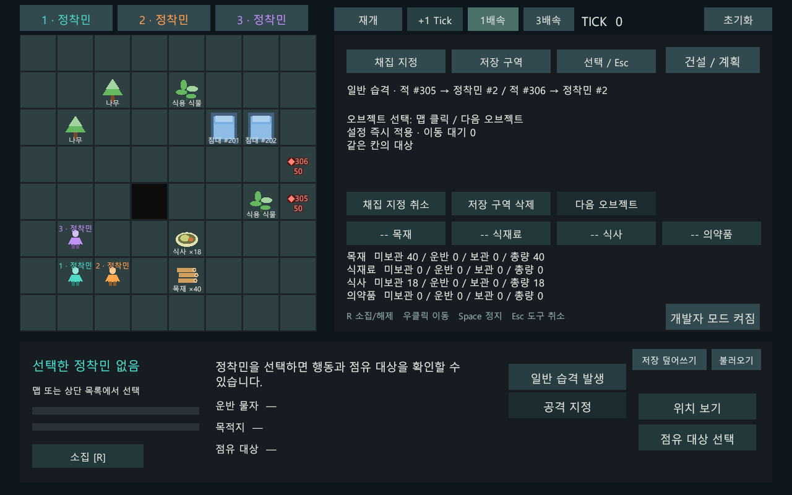
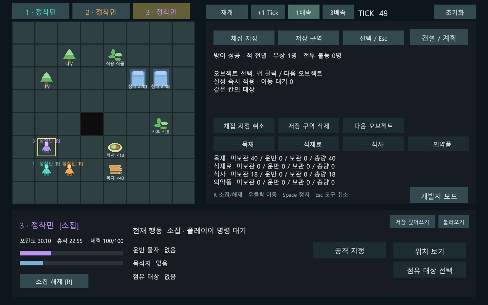

# 일반 습격 즉시 진입 · 실행 검증

2026-11-19. [구현 계획과 완료 조건](../Plans/DebugRaid.md). 개발자 모드에서 일반 습격을 한 번 실행하면 현재 월드에서 적 2명이 즉시 출현한다. 적은 가로·세로 거리 합이 가장 작은 정착민을 고르고 동률이면 작은 ID를 고른다. 유효한 표적은 유지하며 비치명 피격 후 재계산할 확률은 초기 시험값 30%다.

빌드 기준은 보존 브랜치 `37b457a`와 로컬 습격 변경이다. 아래 수치와 화면은 이 조합에서 얻었다. 최신 main 및 다른 세션과의 통합 범위는 [현재 상태](../Status.md)를 따른다.

## 실행 결과

| 확인 범위 | 관찰한 결과 | 실행 폴더 (TestResults) |
|---|---|---|
| EditMode 179/179 | 운반 작업 중 발동해도 시간·행동 ID·운반량·위치 유지. 막힌 진입 칸과 전원 불능에서 거부. 부상한 정착민 한 명만 남아도 발동. 확률 0%/100%와 추첨값 29/30에서 기대한 표적과 난수 소비 확인. | 20261119T070639451Z-c5442b69 |
| 같은 틱의 피해·저장 검사 | 같은 적의 5+5 피해는 체력 50→40과 추첨 1회. 실제 사격 1발은 50→25와 추첨 1회, 동시 2발은 50→0과 추첨 0회. 이전 표적에 이미 성립한 피해 10은 한 번만 반영. 한 번 추첨한 저장을 실제 JSON으로 읽어 다음 난수와 표적, 이후 결과 일치. 변경 전 대기·예고·교전·종료 파일 4개 복원 및 손상된 새 회차 거부 확인. | 같은 EditMode 실행 |
| PlayMode 61/61 | 개발자 모드가 꺼져 있으면 버튼이 숨겨지고 요청도 거부. 정지 상태에서 모드를 켜고 두 번 발생시켜도 같은 월드에 적 2명, 틱 0. 모드를 끈 뒤 소집·공격 지정·초기화 연결 확인. | 20261119T070701161Z-3272644e |
| Windows 빌드 | 성공, 빌드 오류 0·경고 0. | 20261119T070725342Z-build |
| Windows Player | 조리대 없는 정착지에서 0틱에 적 305·306이 정착민 2를 표적으로 삼았다. 모드를 닫고 소집·공격해 49틱에 적 0명, 부상 1명, 전투 불능 0명으로 방어 성공. 이전 시험의 치료·시설 복구·저장 검사도 통과했다. 종료 로그에 기존 ComputeBuffer 해제 경고가 남았다. | 20261119T070755550Z-smoke |

### 즉시 진입

### 방어 결과

처음 캡처에서는 전투 상태가 맵의 나무·식물 이름과 겹쳤다. 상태 문구를 오른쪽 조작 패널로 옮기고 적 표식에 ID를 붙인 뒤 전체 검사·빌드·실행을 다시 마쳤다. 위 두 장은 최종 Windows Player가 생성한 원본 화면이다. 확률 경계는 규칙 검사에서 확인했다.

## 직접 확인

실행 파일은 `E:/Dev/RimworldTweak/Builds/Windows/RimworldTweak.exe`다.

1. 시작 후 Space로 일시정지하고 현재 TICK을 본다. 오른쪽 아래 **개발자 모드**를 누르면 아래 패널에 **일반 습격 발생**이 나타난다.
2. **일반 습격 발생**을 한 번 누른다. 틱은 그대로이고 동쪽에 적 둘이 나타난다. 오른쪽에 각 적과 표적 정착민 번호가 표시된다.
3. 개발자 모드를 끈다. 적은 남는다. 정착민을 선택해 R로 소집하고 **공격 지정** 후 적을 클릭한다. 다른 정착민에게도 지시한 뒤 재개한다.
4. 첫 적이 쓰러지면 남은 적을 지정한다. 승리하면 결과 줄에서 방어 성공·부상·전투 불능 인원을 읽을 수 있다.

Windows Player 검사는 게임의 버튼 이벤트와 맵 명령을 자동 호출해 진행했다. 사람의 마우스·키보드 직접 플레이와 30%의 체감 평가는 대기 상태다. 직접 확인 결과는 “모두 정상” 또는 처음 달랐던 단계로 기록한다.
